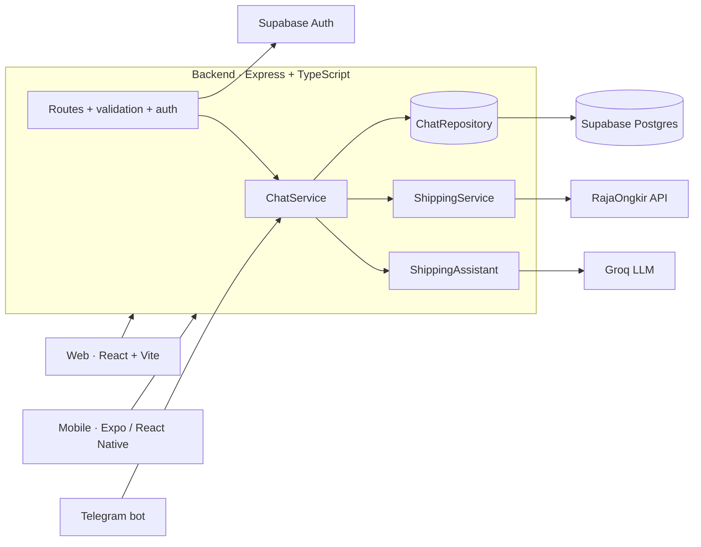

# 📦 Skuy Ongkir

**An AI shipping-cost assistant for Indonesia.** Chat naturally ("kirim 2kg dari Jakarta ke Bali, yang termurah") and get live rates from JNE, POS, TIKI, SiCepat and AnterAja, in a web app, a mobile app and a Telegram bot, all backed by one REST API.

[](https://github.com/OWNER/skuy-ongkir-ai/actions/workflows/ci.yml)

<!-- Add screenshots to docs/screenshots and uncomment:
  -->

## Features

- 💬 **Conversational rate lookup**: an LLM collects origin, destination, weight and preference, then the server fetches real prices (the model never invents numbers).
- 🏷️ Sort by **cheapest**, **fastest**, **best value** (a price/speed score) or show **all** options.
- 🌐 Indonesian / English UI, and the assistant replies in the language you write in.
- 🔐 Email sign-up / sign-in (Supabase Auth), JWT sessions with silent refresh.
- 🕘 Chat history per user, including the rate cards of old conversations.
- ⭐ Star ratings + admin dashboard (searches, users, online now, popular routes, reviews).
- 🤖 Optional Telegram bot that reuses the exact same chat service.

## Architecture



| Folder | What it is |
| --- | --- |
| [`backend/`](backend) | REST API (Node 20+, Express 5, TypeScript, Zod). Layered, constructor-injected classes, unit + HTTP tests. |
| [`web/`](web) | React 19 + Vite + TypeScript SPA with routing, i18n and CSS modules. |
| [`mobile/`](mobile) | Expo SDK 54 app (TypeScript) with the same feature set. |
| [`supabase/`](supabase) | `schema.sql`: tables, indexes and Row Level Security. |
| [`docs/`](docs) | [API reference](docs/API.md), [architecture notes](docs/ARCHITECTURE.md), [deployment guide](docs/DEPLOYMENT.md). |

More detail: [docs/ARCHITECTURE.md](docs/ARCHITECTURE.md).

## Getting started (local)

**Prerequisites:** Node 20+, a free [Supabase](https://supabase.com) project, a [Groq](https://console.groq.com) API key and a [RajaOngkir (Komerce)](https://rajaongkir.komerce.id) API key.

1. **Database**: open Supabase → *SQL Editor* and run [`supabase/schema.sql`](supabase/schema.sql).
   For quick local testing, disable *Confirm email* under *Authentication → Providers → Email*.
2. **Backend**
   ```bash
   cd backend
   cp .env.example .env      # fill in the keys (see comments inside)
   npm install
   npm run dev               # http://localhost:3000/api/health
   ```
   Put your own email in `ADMIN_EMAILS` to get the admin dashboard after you register.
3. **Web**
   ```bash
   cd web
   cp .env.example .env      # VITE_API_URL=http://localhost:3000
   npm install
   npm run dev               # http://localhost:5173
   ```
4. **Mobile** (optional): see [`mobile/README.md`](mobile/README.md). Use your laptop's LAN IP as `EXPO_PUBLIC_API_URL`.

## Quality

| | Command | Covers |
| --- | --- | --- |
| Backend | `npm test` · `npm run lint` · `npm run typecheck` | sorting, city matching, LLM output validation, chat flow, auth/admin guards, stats |
| Web | `npm test` · `npm run lint` · `npm run build` | HTTP client (token refresh), auth form, helpers |
| Mobile | `npm run typecheck` · `npm run lint` | strict TypeScript |

GitHub Actions runs all of them on every push ([`.github/workflows/ci.yml`](.github/workflows/ci.yml)).

## Security notes

- Secrets live only in the backend `.env`; the clients ship **no** keys. The database is reachable only through the API (RLS enabled, service-role key used server-side).
- Every protected route verifies the Supabase JWT; admin rights come from `ADMIN_EMAILS` on the server.
- Input validated with Zod, `helmet`, CORS allow-list, rate limits (stricter on auth and chat), request-size limit.
- LLM output is parsed and validated before it influences anything.

## Deploy for free

Backend on **Render**, web on **Vercel**, database on **Supabase**: step by step in [docs/DEPLOYMENT.md](docs/DEPLOYMENT.md).

## Tech stack

TypeScript · Node.js · Express 5 · Zod · Pino · Vitest · Supertest · React 19 · Vite · React Router · Recharts · Expo / React Native · Supabase (Auth + Postgres) · Groq (Llama 3.3 70B) · RajaOngkir · GitHub Actions

## License

[MIT](LICENSE)
